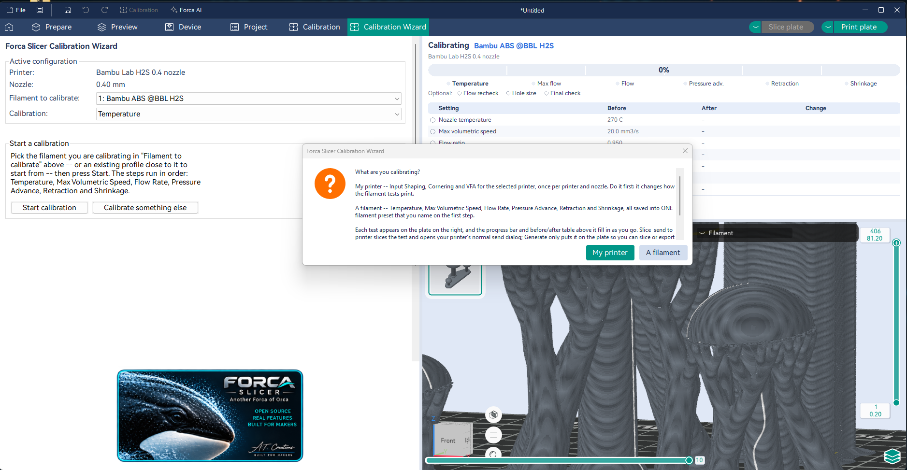
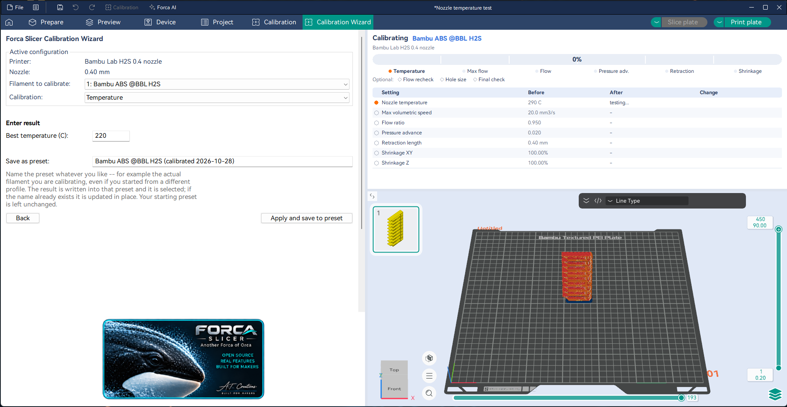
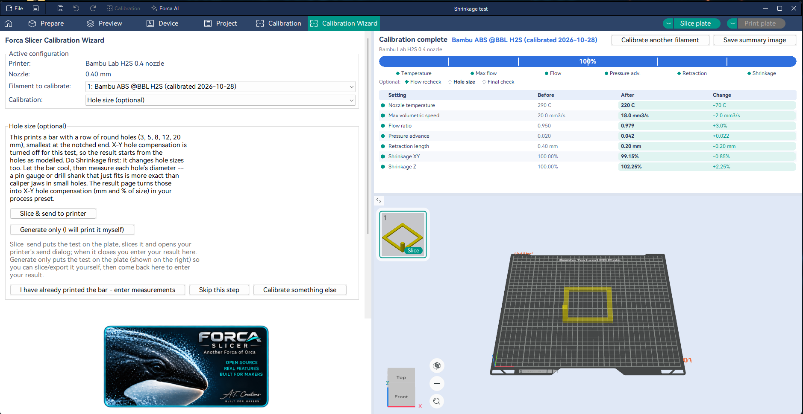
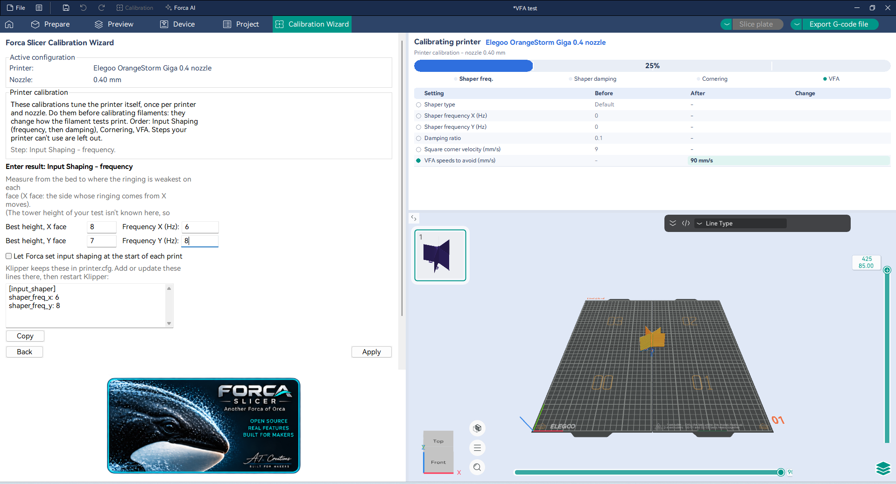

# Calibration Wizard

OrcaSlicer has a calibration test for almost everything, but you pick each one from a menu, work out the result
yourself and type it into the right setting. The **Calibration Wizard** tab walks you through them in order, works
out each value from what you measure, and keeps track of where you are.

It has two tracks: **My printer** (once per printer and nozzle) and **A filament** (once per filament). Do the printer
first if you're going to: it changes how the filament tests print.

## Start

Open the **Calibration Wizard** tab. Under **Active configuration** it shows the printer, nozzle and filament it will
calibrate. Choose what you're calibrating, **My printer** or **A filament**, and press **Start calibration**.

The progress bar across the top shows every step. Click a step to open it, and use **Skip this step** to keep your
current value for a setting and move on. A run is kept per printer and filament: **Start** continues where you left off,
even after closing Forca.

For each test you can **Slice && send to printer** or **Generate only (I will print it myself)**, for SD-card printing.
If you already printed the test, use **"I have already printed ... - enter result"** to go straight to the result.

## The filament track

In this order (the ones in brackets are optional):

| Step | What you do | What it sets |
| --- | --- | --- |
| **Temperature** | Print Orca's temperature tower and enter the best temperature. | Nozzle temperature |
| **Max Volumetric Speed** | Print the flow tower and enter the max flow it reached cleanly. | Max volumetric speed |
| **Flow Rate** | Two passes, coarse then fine (method **Classic** or **YOLO**); enter the number of the block with the smoothest top. Or **Weigh a printed plate**: one solid plate, weighed (see below). | Flow ratio (and density, when weighed) |
| **Pressure Advance** | **PA Tower** (recommended), **PA Line** or **PA Pattern**; enter the height, line or pattern that looks best. For the tower, Forca turns the height into the value. | Pressure advance |
| (**Flow recheck**) | One more flow pass after PA, since PA changes how the top looks. | Flow ratio |
| **Retraction** | Print the retraction tower and enter the number of rings below the cleanest section; Forca turns it into a length. | Retraction length |
| **Shrinkage** | Print Forca's shrinkage frame and enter the measured X and Y widths (and the post height). | Shrinkage XY / Z |
| (**Hole size**) | See [Hole compensation by size](hole-compensation.md). | X-Y hole compensation (process preset) |
| (**Final check print**) | One print with everything together. | — |

### Flow by weight

With a kitchen or jewellery scale that reads 0.01 g, flow can be measured instead of judged by eye. Choose the method
**Weigh a printed plate**: Forca puts a solid 40 x 40 x 3 mm plate on the bed (100 % infill, no brim, no ironing).

1. **Slice it before printing.** The slice says what the plate should weigh, and the result page fills that in as
   **Expected weight**, without the skirt, brim and purge lines.
2. Print it, let it cool, take off the skirt and any strings, and enter its weight as **Plate weight**.
3. Optional but worth it: cut exactly 1 m of the filament and enter its weight. Forca works out the filament's real
   density from it, so a wrong density in the preset isn't mistaken for too much or too little flow, and saves the
   measured density with the result.

The new flow ratio is **expected / measured**: a plate 2 % too heavy means the printer extrudes 2 % more than it's
told, so the flow ratio becomes 0.98 of what makes it exact. This one pass replaces both visual passes, and the two
weights go into the [Forca Academy](forca-academy.md) journal with the result.

Each result page checks your number against a plausible range, so a typo (a missing decimal point) is caught before
it reaches your preset.

**Where the results go:** into **one new filament preset**, named under **Save as preset** (Forca suggests
"<your filament> (calibrated <date>)"). Each step's **Apply and save to preset** adds its value to that preset and
selects it. Your starting preset is never changed. A before/after table shows every value, and
**Save summary image** saves it as a PNG.

## The printer track

Once per printer and nozzle, in this order. Steps your printer can't use are left out.

| Step | What you do |
| --- | --- |
| **Input Shaping - frequency** | Print Orca's ringing tower; find the height on the X and the Y face where the ringing after corners is weakest. |
| **Input Shaping - damping** | Print the damping tower and find the best height in the same way. |
| **Cornering** | The tower raises the cornering speed (jerk, junction deviation or Klipper's square corner velocity) with height; find the highest point where the corners are still sharp. |
| **VFA (vertical fine artifacts)** | The tower steps the outer wall speed up block by block; note the blocks with fine vertical ribbing. The result is a list of **speeds to avoid** for outer walls. |

The result page turns each height into a value. You choose whether it updates **your printer preset** (Forca keeps a
backup; **Restore this printer's backup** puts it back) or goes into a **new "(calibrated)" printer preset**.

Notes per printer:

- **Bambu Lab printers** tune their own input shaping and cornering, so only **VFA** applies to them.
- **Klipper** keeps input shaping in `printer.cfg`: the result page shows the lines to add or update there; restart
  Klipper afterwards. Cornering is tested as square corner velocity.
- **Let Forca set input shaping at the start of each print** writes the shaper values into the G-code (Orca's "Emit
  input shaping"), overriding what the firmware has stored. Leave it off if you keep them in the firmware.

## Calibrating another filament

**Calibrate another filament** starts the filament track for the filament now selected in the sidebar; the other
filament's progress is kept. The wizard notices when the printer, nozzle or filament changes in another tab and says
so before it mixes results.

All of the wizard is translated into OrcaSlicer's 22 languages.
