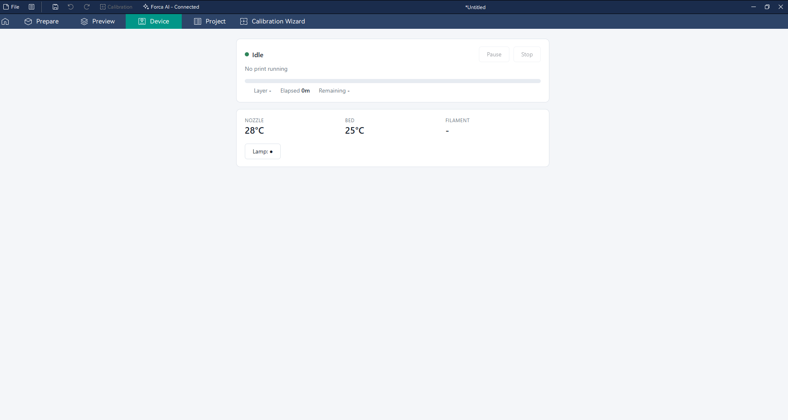

# Flashforge and Klipper printers

Forca adds a few things for printers that aren't Bambu Lab's. They were tested on a stock Flashforge Adventurer 5M
(firmware 5.1.8) and an Elegoo OrangeStorm Giga (Klipper); other printers with the same software should work but
haven't been tested.

## Stock Flashforge printers

A stock Flashforge printer (Adventurer 5M / 5X and others with the same local API) has no web interface, so in
OrcaSlicer its **Device** tab shows "refused to connect". Forca shows its own status page instead.

**Set up:** in the printer's network settings in Forca, enter the printer's address, and its **access code** (shown on
the printer's screen) under **API Key / Password**. Without the access code, the page says what to enter.

**The page shows** the printer's state, the file, progress and layer, **Elapsed** and **Remaining** time,
temperatures and filament, with **Pause** / **Resume**, **Stop** and the **light**.

- While the printer runs its start routine (bed leveling), the page says **Preparing**: the printer ignores Pause
  until the first layer starts.
- After a print, the printer refuses the next job until the plate is confirmed clear. **Plate is clear** on the page
  does that once you've taken the print off.

With the [print journal](forca-academy.md) on, Forca follows prints sent to the printer to the end and records how
they ended, as long as Forca is open and can reach the printer. Pictures from a Flashforge printer's built-in camera
are untested.

## Klipper printers (Moonraker)

- **Find Fluidd or Mainsail:** in the printer's network settings, the **Search** button next to Device UI looks for
  Fluidd or Mainsail on the printer and shows it in the Device tab. It looks in the usual places (the printer's
  address, ports 81 / 4408 / 4409, `/fluidd`, `/mainsail`); type the address in Device UI if yours is elsewhere.
- **Port 7125:** a printer set up with Moonraker's port 7125 opens Fluidd or Mainsail in the Device tab, instead of
  Moonraker's API page.
- **A printer on another port** (for example a KX-Bridge on 7125) keeps its port after the first connection.
- **Clearer logs:** when a connection, lane data or Happy Hare query fails, the log names the address, which server
  answered and the start of its reply (never the API key).
- **Filament sync from Happy Hare and Moonraker lane data** (experimental) includes an OrcaSlicer fix that isn't in
  OrcaSlicer yet, for Happy Hare printers whose lane data is still empty. A lane picks its preset by the lane's
  filament id, as in OrcaSlicer; without one, by its material. On some set-ups (KX-Bridge), filaments can still land in the wrong slots or come in as generic
  presets.

With the print journal on, Forca follows Klipper prints to the end too, while it's open and can reach the printer.
