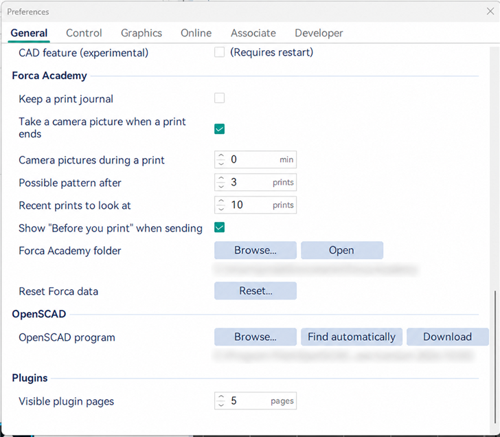
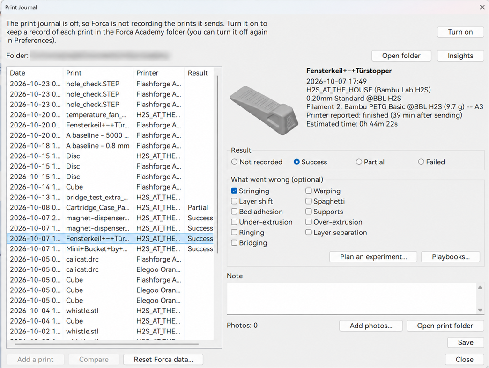
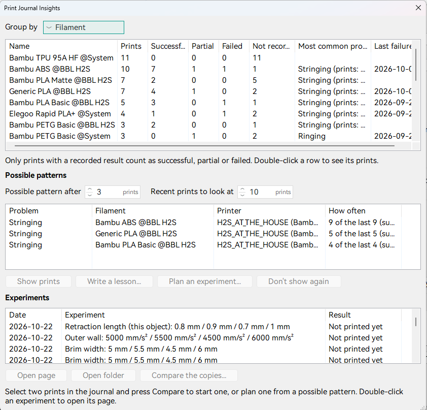
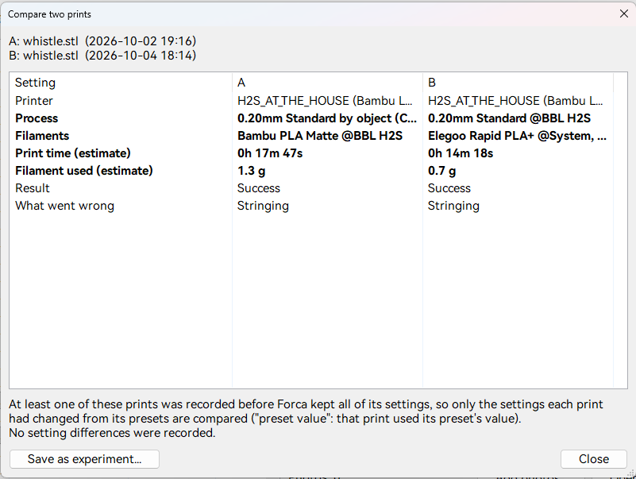
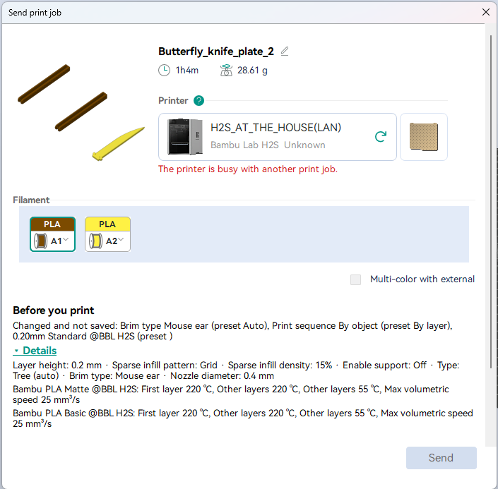

# Forca Academy: the print journal

Slicer settings are learned by printing: a PETG part strings, you change a setting, the next one doesn't. A slicer
forgets all of that. **Forca Academy** keeps it: a print journal of every print Forca sends, how it went, and what you
learned, as plain Markdown and JSON files in a folder on your computer. Nothing is uploaded.

Forca records the facts. The judgments (how a print went, notes, lessons) are yours; Forca only ever proposes them.

## Turn it on

**Preferences > General > Forca Academy** (it's off by default):

- **Keep a print journal** records every print Forca sends.
- **Take a camera picture when a print ends**: one picture of the result, for Bambu printers with a camera Forca can
  reach on the local network.
- **Camera pictures during a print**: every how many minutes Forca keeps a picture while it runs, so a failure can
  be traced back (0 = off; Bambu printers only).
- **Possible pattern after** and **Recent prints to look at**: when Insights point out a pattern (below).
- **Show "Before you print" when sending** (below; works without the journal too).
- **Forca Academy folder**: **Browse...** chooses where it's kept (default `Documents\Forca Academy`); **Open** opens
  it.



## What gets recorded

Every print Forca sends: to a Bambu printer, and uploads to other printers when they start or queue the print. For
each, its own folder (`prints/<year>/<date>_<time>_<name>/`) with:

- the printer, the process and filament presets (on Bambu printers, the AMS tray each filament came from), and the
  settings you changed and didn't save;
- every setting the print used, the plate and its objects, the estimates, and a picture of the plate.

While the print runs, Forca follows it to the end on **Bambu**, **Klipper (Moonraker)** and **stock Flashforge**
printers, and records how it ended ("Printer reported: finished / failed / stopped"). Forca has to stay open and able
to reach the printer for that.

For prints Forca didn't send, such as one started from an SD card, **Add a print** in the Print Journal records the
plate as it is now.

## The Print Journal

**File > Print Journal** lists your prints, newest first. For each print:

- mark the outcome: **Success**, **Partial** or **Failed**;
- tick quick tags for **What went wrong**: Stringing, Warping, Layer shift, Spaghetti, Supports, Under-extrusion,
  Over-extrusion, Ringing, Layer separation, Bridging;
- write a note;
- **Add photos** (or drop photos and videos on the window); **Open print folder** shows the files.



## Insights

**Insights** in the Print Journal groups your prints by printer, filament or process: how many went well, partly or
failed, the most common problem and the last failure. Double-click a row to see its prints.

**Possible patterns**: when the same problem tag is on several of the recent prints with one printer and filament (3
of the last 10 by default), Insights point it out. For each you can:

- **Show prints**;
- **Write a lesson**: Forca drafts one from the journal; you write the rule you take from it and how sure you are,
  and it goes into `lessons.md`;
- **Plan an experiment**: see [Guided experiments](guided-experiments.md);
- stop showing it.

**Playbooks** opens the playbook for a problem: likely causes, checks, and the Forca settings and Calibration Wizard
tests that address it. Forca writes a starter playbook for each tag; after that it's yours to edit.



## Compare two prints

Select two prints (**Ctrl+click**) and press **Compare** to see them side by side: printer, presets, estimates,
outcome and tags, then every setting that differed (in bold). **Save as experiment** writes a page in the
`experiments` folder with both prints and what differed; add the result once you know which came out better.



## Before you print

When you send a print, the send dialog shows **Before you print**:

- how earlier prints with the same printer and filament went (with the journal on);
- the settings you changed and didn't save;
- collapsed **Details**: the values that most often decide a print (layer height, infill, supports, brim, nozzle, and
  per filament its temperatures and max volumetric speed).

It also points out known fixes, such as **Thick external bridges** when earlier prints were tagged Bridging. It never
stops or delays a send.



## Your folder

Everything is plain files you can read, edit, back up or hand to an AI:

```
INDEX.md, lessons.md, AGENTS.md    your pages (AGENTS.md tells an AI how to read and write here)
printers/  materials/              a page per printer and filament
playbooks/                         a playbook per problem tag
prints/<year>/<print>/             record.json, settings.json, notes.md, the pictures, photos/ and camera/
experiments/                       experiments and saved comparisons
```

Forca writes its facts between `<!-- forca:... -->` markers (in `notes.md`, the printer pages and `INDEX.md`). Text
outside them is yours and Forca leaves it alone; if you delete a block's markers, Forca leaves that page alone too.
Printer keys and access codes are never stored.

To start the journal again, use **Reset Forca data** ([Getting started](getting-started.md#reset-forca-data)).
