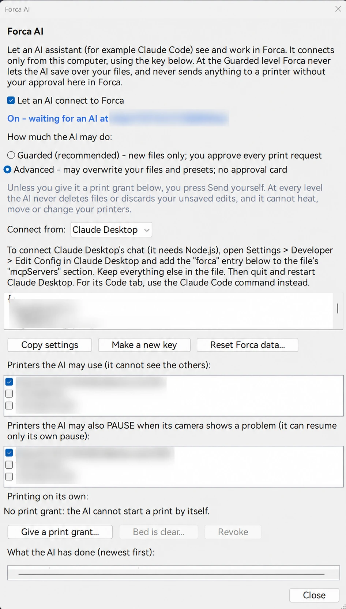
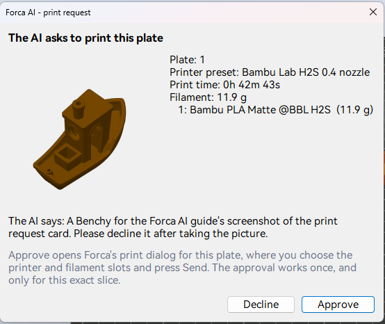

# Forca AI

**Bring your own AI, or don't.** Forca has no AI built in: no AI model, no AI account, nothing sent to an AI service.
Forca AI is a door that *your* AI app (Claude Code, Claude Desktop, Codex, or any app that supports MCP, cloud or local) can
use to see and work in Forca with you. It stays shut unless you open it: while it's off, nothing is listening, and
Forca works like a slicer with no AI.

Forca AI is experimental.

## What it can do

An AI you connect can load and arrange models, design models in OpenSCAD ([OpenSCAD models](../openscad.md#forca-ai)),
choose presets, add modifiers and support regions, slice and read the results, save a copy of the project, and, with
the print journal on, read your [Forca Academy](forca-academy.md) journal and its Insights. For printers you choose, it
can read their status and take a camera snapshot.

## Turn it on

Click **Forca AI** in the top bar.

1. Tick **Let an AI connect to Forca**. It connects only from this computer, with the key shown in the window.
2. Connect your AI app: pick it under **Connect from** and follow the steps below.
3. Choose **Printers the AI may use**; it can't see the others.

**Make a new key** disconnects every AI using the old key; connect them again with the new command or settings.
One key serves every Forca on this computer, so the installed Forca and a second copy share it.

### Connect Claude Code

Choose **Claude Code**, click **Copy command** and run the command once in a terminal. This also covers the **Code**
tab of the Claude desktop app, which uses Claude Code's settings.

Claude Code loads Forca's tools when a session starts. Start Forca and turn Forca AI on first, then start a new
session; a session started while Forca was closed has no Forca tools.

### Connect Claude Desktop's chat

Claude Desktop's chat can't use Forca's connection directly: it only starts helper programs on your computer. A
small free helper, [mcp-remote](https://github.com/geelen/mcp-remote), passes its messages on to Forca. It needs
[Node.js](https://nodejs.org) (version 18 or newer); Claude Desktop downloads mcp-remote itself the first time.

1. Install Node.js if you don't have it.
2. In Forca's AI window, choose **Claude Desktop** and click **Copy settings**.
3. In Claude Desktop, open **Settings**, then **Developer** (under **This computer**), then **Edit Config**. This
   opens the folder with `claude_desktop_config.json`; open that file in a text editor and save a copy first.
4. Don't replace the file: Claude Desktop keeps its own settings in it. Add only Forca's part:
   - If the file has an `"mcpServers"` section, add the `"forca": { ... }` entry inside it, with a comma between it
     and the next entry.
   - If it has none, add the whole `"mcpServers": { ... }` block you copied right after the file's first `{`, with a
     comma after the block.
   - Only if the file is empty or just `{}`, replace it with what you copied.
5. Save the file, quit Claude Desktop completely (also from the system tray) and start it again.

Forca must be running with Forca AI on when Claude Desktop starts. If Claude Desktop shows a Forca error, turn
Forca AI on and restart Claude Desktop. After **Make a new key**, copy the settings again and replace the old
`"forca"` entry.

Custom connectors (in Claude's **Settings > Connectors**, and on claude.ai) can't reach Forca: they connect from
Anthropic's servers, and Forca only accepts connections from your own computer.

### Connect Codex (ChatGPT)

ChatGPT's own chat can't reach Forca for the same reason: its connectors run on OpenAI's servers. Codex, OpenAI's
agent in the ChatGPT desktop app (also the Codex app and CLI), runs on your computer and signs in with your ChatGPT
account.

1. In Forca's AI window, choose **Codex (ChatGPT)** and click **Copy settings**.
2. Either paste the lines at the end of `config.toml` in the `.codex` folder of your user folder
   (`C:\Users\<you>\.codex\config.toml`; create the file if it isn't there), or, in Codex's MCP settings, add a
   **Streamable HTTP** server named `forca` with the URL and the `Authorization` header from those lines.
3. Restart Codex.

### Connect another app (local AI, Grok, and others)

Any app that can use MCP servers over **Streamable HTTP** can connect. Choose **Other app (MCP)** and click **Copy
settings**: you get the address and an `Authorization: Bearer <key>` header, in the `mcpServers` JSON many apps read.

- **LM Studio** (local models): in the **Program** tab, **Install > Edit mcp.json**, add the `"forca"` entry to its
  `mcpServers` section, and save. Use a model that supports tool use.
- **Chat apps that run Grok, ChatGPT, Gemini or a local model** with your own API key or an Ollama server, such as
  Open WebUI or Cherry Studio: add an MCP server of type Streamable HTTP with the address and the header (or the key as
  its bearer token).

xAI's and OpenAI's own server-side tool connections can't reach Forca: like Claude's connectors, they connect from
the internet. Small local models often struggle with Forca's many tools; a larger model with good tool use works best.

**What the AI has done** lists every action, newest first, and every AI edit is one undo step (**Ctrl+Z**).

## Guarded and Advanced

**How much the AI may do:**

| | **Guarded** (default, recommended) | **Advanced** |
| --- | --- | --- |
| Your files | Never saved over: every save gets a new "(Claude <date>)" name. | May save over your files; Forca first copies each one into `Documents\Forca AI\Backups`. |
| Your presets | Never edited. | May edit your own presets (never system presets). |
| Printing | It can only *ask*: you approve on a card in Forca, then choose the printer and press Send in the usual print dialog. | A print request opens the print dialog directly; you still press Send. |

At **every** level the AI can't delete files, discard your unsaved edits, or heat, move or reconfigure a printer, and
it never sees printer access codes, passwords, API keys or network addresses. It can't set, in any preset it makes or
changes: post-processing scripts, G-code templates (start, end, tool change...), the output file name, the printer
connection or secrets. Only you can change the level, in this
window; the top bar shows **(Advanced)** while it's on.

### The print approval card

When the AI asks to print, Forca shows **Forca AI - print request** with the plate, the printer preset, the print
time and what the AI says. **Approve** opens Forca's print dialog for that plate, where you choose the printer and
filament slots and press Send. An approval works once, and only for that exact slice. A chat message saying you
approve is not an approval.

## Print grants (Advanced only)

A print grant lets the AI start prints on its own, for a while, within limits you set. **Give a print grant...**:

- **Printers**, **Prints the AI may start**, **For the next (hours)** and **Longest print (hours)**;
- optionally **What to print**: files (with copies and a note for the AI each); then Forca sends only plates made from
  those files;
- **The bed of these printers is clear now**.

Forca sends a grant print only to a shared printer that's selected in the Device tab, idle, and whose **bed is clear**:
you clicked **Bed is clear...** since its last print (one clearing, one print), or, if you also ticked **Also let the
AI decide by camera that a bed is clear**, the AI judged a fresh camera picture. The AI must name the AMS slot or
external spool for every filament, and Forca checks the material. Then it opens the print dialog, counts down 10
seconds (you can cancel) and presses Send. If the dialog would ask you to confirm a warning, the send stops instead.

A grant ends when it's used up, at its time limit, on **Revoke**, when you choose Guarded, or when Forca restarts. The
top bar shows how many prints are left. Grants work with Bambu Lab printers only for now.

> The camera can't see the whole bed on every printer (an H2S camera, for one, misses the strip nearest the door).
> Turn on the camera bed check only if you're fine with that; your own **Bed is clear** click has no blind spot.

## Pausing a failing print

Under **Printers the AI may also PAUSE when its camera shows a problem**, tick the printers where the AI may pause a
print it sees failing. Forca then shows **Forca AI - print paused** with why; **Keep paused** or **Resume print**. The
AI may resume only its own pause, and only while the print stays paused.

## Good to know

- Only connect AI apps you trust: an AI you connect sees the models and settings you work on.
- After updating Forca, reconnect your AI app so it loads Forca's current tools (a new Claude Code session, or a
  restart of Claude Desktop).
- [SECURITY.md](../../../SECURITY.md) describes every protection in detail.
- To start Forca AI again from scratch (new key, no shared printers, Guarded, off), use
  [Reset Forca data](getting-started.md#reset-forca-data).
