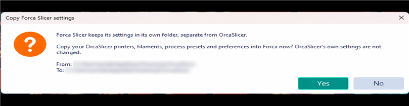
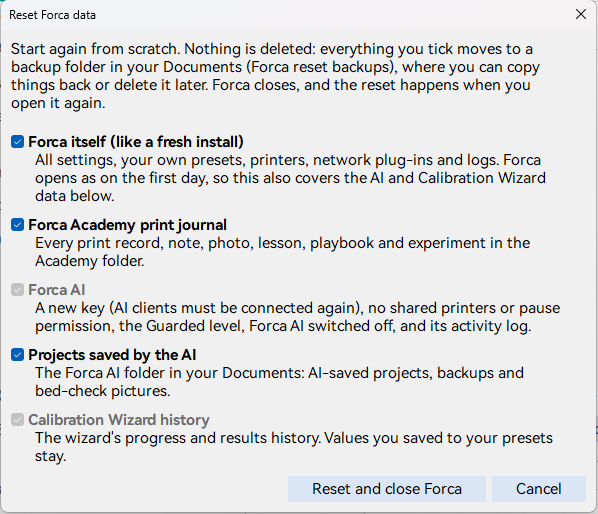

# Getting started with Forca

Forca Slicer is OrcaSlicer with additions. Everything you know from OrcaSlicer works the same way; the
[other guides](README.md) cover what Forca adds. This page covers installing Forca next to your current slicer,
bringing your settings over, and starting again if you need to.

## Install

Download the installer or the portable zip from [Releases](https://github.com/tayloraaron078-tech/ForcaSlicer/releases)
(Windows 64-bit). The [README](../../../README.md#install-windows) explains both. Forca installs as its own program,
**Forca Slicer**, so OrcaSlicer stays installed and untouched.

## Your settings

Forca keeps its settings in its own folder, `%APPDATA%\ForcaSlicer`, not in OrcaSlicer's.

**On first start**, if OrcaSlicer is installed, Forca asks once whether to copy your OrcaSlicer printers, filaments,
process presets and preferences into Forca. The dialog shows both folders.

- **Yes** copies them. OrcaSlicer's folder is only read, never changed. Logs, caches, preset backups and your Orca
  Cloud sign-in are not copied.
- **No** starts Forca with fresh defaults. Forca doesn't ask again.

After copying, check the printer, nozzle and presets selected in the sidebar before your first print, as you would
after any change of slicer.

### Favourite settings

Right-click the name of a process setting you change often and choose **Add to favorites**. It then also appears on a
**Favorites** page, first in the process settings, so the settings you use most are together. Right-click it there
(or on its own page) and choose **Remove from favorites** to take it off. The page only shows while it has settings. A line with
several settings (such as **Bridge**, with its External and Internal speeds) is added as the whole line.

Favourites belong to you, not to a preset: they stay the same whatever process preset is selected, and they aren't
saved in presets or projects. They cover process settings for now.

## What Forca doesn't connect to

- **No Orca Cloud.** Forca doesn't sign in to or sync with Orca Cloud (the OrcaSlicer team's service); your presets
  stay on your computer. Presets you kept under an Orca Cloud account are merged into your local presets once.
- **No OrcaSlicer update server.** Forca checks only its own GitHub releases for a newer Forca when it starts (not in
  Stealth mode). New printer profiles arrive with new Forca versions.
- **Bambu Cloud** is Bambu Lab's service, not Orca's, and works as in OrcaSlicer.

Bug reports go to Forca: **Help > Report a Bug or Request a Feature** opens Forca's issue forms on GitHub. Please
report Forca problems there, even when you think the bug is OrcaSlicer's.

## Trying Forca safely

Forca is an alpha. Until it has earned your trust:

- Keep your normal slicer installed.
- Slice a familiar model first and compare the preview and the time estimate with what you're used to.
- Check the preview and the first layers of anything that matters.

## Reset Forca data

**Reset Forca data** starts part or all of Forca again from scratch. It's in **Preferences** (General, at the end of
the Forca Academy section), in the **Forca AI** window and in the **Print Journal**. Tick what to reset:

| Choice | What goes |
| --- | --- |
| **Forca itself (like a fresh install)** | All settings, your own presets, printers, network plug-ins and logs. Forca opens as on the first day, so this also covers the Forca AI and Calibration Wizard data. |
| **Forca Academy print journal** | Every print record, note, photo, lesson, playbook and experiment in the Academy folder. |
| **Forca AI** | A new key (AI clients must be connected again), no shared printers or pause permission, the Guarded level, Forca AI switched off, and its activity log. |
| **Projects saved by the AI** | The Forca AI folder in your Documents: AI-saved projects, backups and bed-check pictures. |
| **Calibration Wizard history** | The wizard's progress and results history. Values you saved to your presets stay. |

**Nothing is deleted.** Forca closes, and when you open it again everything you ticked moves to
`Documents\Forca reset backups`, where you can copy things back or delete them later. If a file can't be moved, Forca
tells you which.

