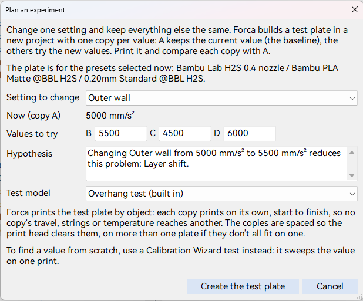
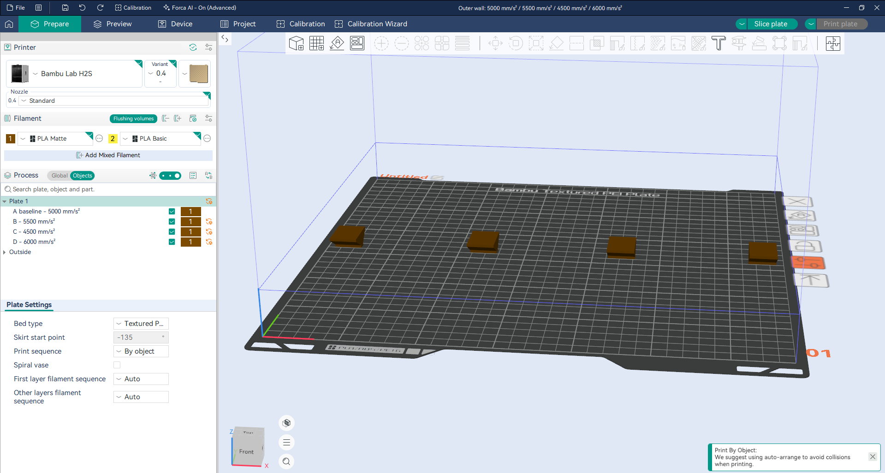
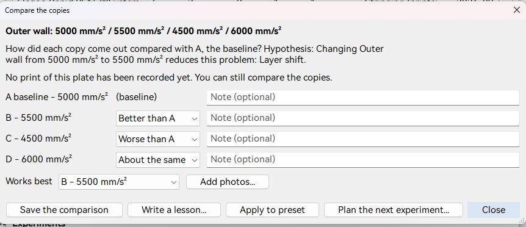

# Guided experiments

When a problem keeps coming back (stringing with one filament, sagging bridges on one printer), the usual fix is to
change a setting, print, change another, print again, and lose track of what helped. A **guided experiment** tests
**one setting** on **one plate**: a copy with your current value, and copies with up to three values to try, printed
side by side so they can be compared fairly.

Experiments are part of [Forca Academy](forca-academy.md): turn the print journal on first.

> To find a value from scratch (a temperature, a retraction length), use the [Calibration Wizard](calibration-wizard.md)
> instead: its tests sweep the value on one print. An experiment compares a few specific values.

## Plan an experiment

Open **Plan an experiment** from a possible pattern in **Print Journal > Insights**, or from the Print Journal next to
**Playbooks** (for a problem you choose). Then:

1. **Setting to change**: Forca lists the settings that suit the problem; **Another setting** offers any setting that
   can differ between objects on one plate.
2. **Values to try**: up to three. **Now (copy A)** shows your current value, the baseline.
3. **Hypothesis**: what you expect, for example "Changing retraction length from 0.8 to 1.2 reduces this problem:
   stringing". Forca fills in a starting sentence.
4. The **test model**: a built-in **Bridge test**, **Overhang test** or **Stringing test: two towers**, or an object
   in your project.
5. **Create the test plate**.

The plate is built for the presets selected now, which the dialog names.

## The test plate

Forca builds the plate in a **new project**:

- **A baseline** keeps the presets' value; **B**, **C** and **D** each carry their value as a per-object setting.
  Nothing else differs between the copies, and your presets aren't changed.
- **The plate always prints by object**: each copy prints on its own, start to finish, so no copy's travel, strings
  or temperature reaches another. (That's also what lets a nozzle temperature or fan speed differ per copy.) This is
  set in the plate's settings; your process preset is unchanged.
- The copies are spaced so the print head clears them. When they don't all fit on one plate, Forca spreads them over
  more than one.

Check the plate and the preview, then print it as usual. When it's sent, the print's record and the experiment are
linked.

## Compare the copies

In **Print Journal > Insights**, under **Experiments**, pick the experiment and press **Compare the copies**:

1. For each copy: **Better than A**, **About the same** or **Worse than A**, with an optional note.
2. **Works best**: Forca proposes the first copy rated better; change it if you disagree.
3. Add photos of the printed plate, and **Save the comparison**.

Then:

- **Write a lesson**: Forca drafts one from the comparison; edit it and add it to `lessons.md`.
- **Apply to preset**: sets the winning value in the preset you're editing. It isn't saved: you decide whether to
  save the preset.
- **Plan the next experiment**, for example to narrow the value down further.

Each experiment has its own page in the Academy's `experiments` folder (**Open page**): the plan, the prints, the
comparison and your result. The Experiments list shows where each one stands: Not printed yet, Printed, not compared
yet, or Compared.

A winner on a small test model is good evidence, not proof: try the value on a real part before relying on it.

