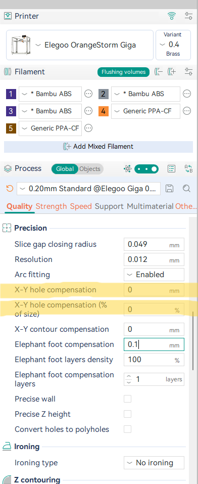
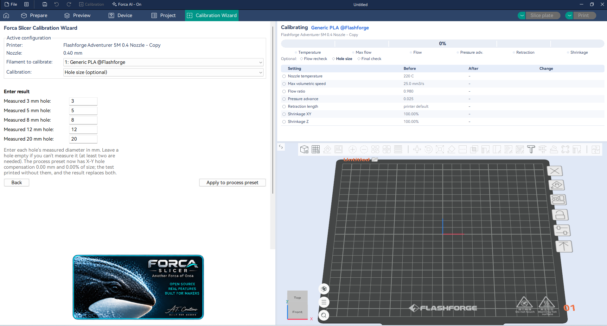

# Hole compensation by size

Printed holes usually come out too small. OrcaSlicer's **X-Y hole compensation** fixes that by a fixed amount: 0.1 mm
makes every hole 0.1 mm wider, whatever its size. But holes often shrink in proportion to their size, so a value that
fits a 3 mm hole is too little for a 20 mm one.

Forca adds **X-Y hole compensation (% of size)**: each hole grows (or shrinks) by a percentage of its own diameter.
1% makes a 10 mm hole 0.1 mm wider and a 3 mm hole 0.03 mm wider.

## The setting

**Quality > Precision > X-Y hole compensation (% of size)**, next to the fixed **X-Y hole compensation**. Like
the other process settings, it can also be set per object.

- The two add up: the fixed value for what every hole is missing, the percentage for what grows with size.
- Positive values make holes bigger, negative values smaller.
- **0% (the default) changes nothing**, so existing presets slice as before.
- As with the fixed value, it isn't applied to an object painted with several filaments.

## Finding the values

The Calibration Wizard's optional **Hole size** step (filament track, after Shrinkage) works them out for you:

1. Do **Shrinkage** first: it changes hole sizes too.
2. The wizard prints a bar with round holes of 3, 5, 8, 12 and 20 mm, smallest at the notched end. Hole compensation
   is turned off for this print, so it shows the holes as modelled.
3. Let the bar cool, then measure each hole's diameter. A pin gauge or drill shank that just fits is more exact than
   caliper jaws in small holes. At least two holes of different sizes are needed; leave a hole empty if you can't
   measure it.
4. The result page suggests both values, and how close the measured holes should come with them.
5. **Apply to process preset** puts them into your process preset. It isn't saved until you save the preset, so you
   can try them first.

