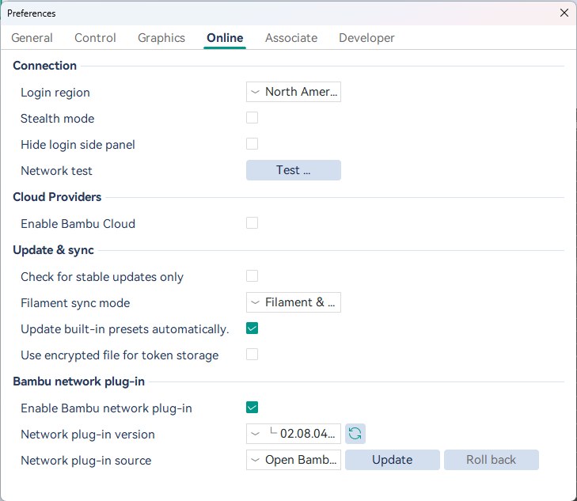

# Open Bamboo Networking

Forca talks to Bambu Lab printers through Bambu Lab's **network plug-in**, a closed library from Bambu Lab that Forca
downloads and loads like OrcaSlicer does. On the plug-in version Forca uses, it sometimes closes Forca shortly after a
print is sent (the print carries on).

[Open Bamboo Networking](https://github.com/ClusterM/open-bamboo-networking) (OBN) is an open-source replacement for
that plug-in (AGPL-3.0). In our tests it didn't have that crash. Forca lets you switch between the two in one place,
and switch back.

## What OBN costs

- Your Bambu Lab printers must be in **LAN-only mode with Developer Mode on**.
- Bambu's cloud features don't work: cloud printing and the camera away from home, Go Live, HMS photos and MakerWorld
  history.

Bambu Lab's plug-in stays the default. If you print over your own network and the crash bothers you, OBN is worth a
try.

## Switch

1. **Preferences**, under the Bambu network plug-in settings: **Network plug-in source**.
2. Choose **Open Bamboo Networking (open source)**. Forca explains what it costs and asks first.
3. Forca downloads OBN from its GitHub releases (the latest stable release only), checks the file against the digest
   GitHub publishes, and puts it in place.
4. **Close and reopen Forca** to finish switching.

To go back, choose **Bambu Lab (official)** the same way.

Use **Network plug-in source** for this, not the plug-in version list next to it.

## Updates and roll back

- **Check for a newer Open Bamboo Networking release** offers an update when there is one. Forca never updates OBN on
  its own, and keeps the previous release.
- **Roll back** goes back to the OBN release you used before.
- When a new Forca moves to a newer Bambu plug-in version, Forca puts the matching OBN build in place at start-up, or
  asks to download it. If you decline, Forca uses Bambu Lab's plug-in until you choose OBN again.
- If OBN doesn't load, Forca switches back to Bambu Lab's plug-in and tells you.

## After a crash

If Forca closed unexpectedly inside Bambu Lab's plug-in, the next time you open the Device tab Forca offers OBN once
for that crash, with **Don't show again**.
