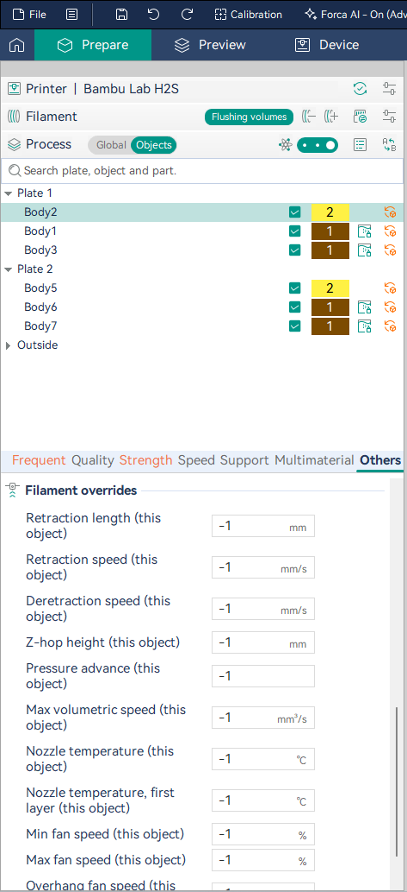

# Per-object filament overrides

OrcaSlicer lets most process settings differ per object (speeds, walls, infill, supports), so two copies on one plate
can test two bridge speeds side by side. Filament settings can't: retraction and pressure advance belong to the
filament, so the same plate couldn't compare two retraction lengths.

Forca adds **Filament overrides** to an object: a small set of filament settings that can differ per object, for
side-by-side tests (Forca's [guided experiments](guided-experiments.md) use them) and for a part that simply needs
different retraction or pressure advance than the rest of the plate.

## Set an override

1. Right-click the object > **Edit Process Settings**.
2. Open the **Others** page, group **Filament overrides**.
3. Set the value you want for this object. Leave the rest at **-1**, which means "use the filament's value" (or the
   printer's, where the filament doesn't set it).

| Override | Works when printing |
| --- | --- |
| Retraction length (this object) | by layer or by object |
| Retraction speed (this object) | by layer or by object |
| Deretraction speed (this object) | by layer or by object |
| Z-hop height (this object) | by layer or by object |
| Pressure advance (this object) | by layer or by object |
| Max volumetric speed (this object) | by layer or by object |
| Nozzle temperature (this object) | by object only |
| Nozzle temperature, first layer (this object) | by object only |
| Min fan speed (this object) | by object only |
| Max fan speed (this object) | by object only |
| Overhang fan speed (this object) | by object only |

## What each one does

- **Retraction length, speeds and Z-hop** apply while the object prints, and when the nozzle leaves it for another
  object. Tool-change retraction keeps the filament's values.
- **Pressure advance** is set when the object starts and the filament's value is restored when it ends. Adaptive
  pressure advance isn't used inside an object with this override.
- **Max volumetric speed** caps the object's flow, its supports included: faster print speeds are lowered to stay
  within it.
- **Nozzle temperature and fan speeds** only work with **Print sequence: By object** (Others page, or the plate's
  settings). Printing by layer, all objects share every layer's temperature and fan, so Forca shows a warning on the
  object instead of silently ignoring the values. With by-object printing, Forca heats to the object's temperature
  before it starts, and waits.

An override covers everything the object prints: all of its filaments and its supports. The **brim and skirt** print
before any object's settings take effect, so they keep the filament's values.

## Tips

- To compare two values, put two copies of a part on the plate and give one the override; or let
  [Plan an experiment](guided-experiments.md) build the plate for you.
- Once you know the value, put it in your filament preset; keep overrides for parts that are genuinely different.
- Overrides are saved in the project. Other slicers don't know them and print the object with the filament's values.
