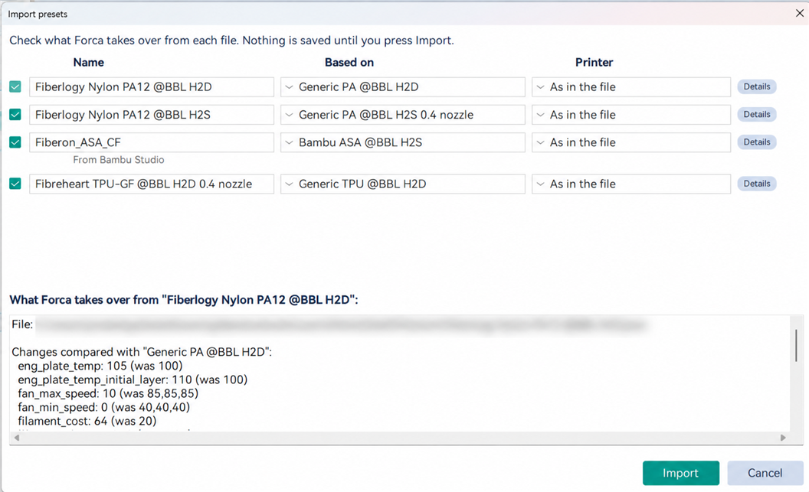

# Importing filament profiles

Filament makers often publish their profiles for Bambu Studio only, and you may have your own profiles in OrcaSlicer.
OrcaSlicer, Bambu Studio and Forca save a preset in the same format, so the files can be read as they are. What
differs is which presets each one is based on, which printers are installed, and a few settings each slicer names its
own way. OrcaSlicer imports what it can and skips the rest without a word. Forca shows you each file first and lets
you settle the differences.

## Import

**File > Import > Import Configs**, or drop the files on Forca's window. It accepts:

- `.json` preset files;
- OrcaSlicer bundles: `.orca_filament`, `.orca_printer`, `.orca_bundle`, `.zip`;
- Bambu Studio bundles: `.bbsflmt`, `.bbscfg`.

Every filament preset, including each filament inside a Bambu Studio bundle, goes through the **Import presets**
review. Process presets in a Bambu Studio bundle import directly. **Nothing is saved until you press Import.**

## The review

One row per file:

- **Name**: the file's name for it, or the same with "(imported)" when you already have a preset with that name.
  Typing the name of one of your own presets asks before replacing it; a system preset's name can't be used.
- **Based on**: the preset it builds on. Most profiles only store what they change from another preset, so this
  matters:
  - when Forca has that preset, it's shown;
  - when Forca knows it under another name, the match is shown;
  - when Forca doesn't have it, Forca suggests the closest one (the same filament for another printer, then the same
    maker and type, then "Generic" of the type) and lets you pick any system filament of that type;
  - "Nothing: a full preset of its own" means the file needs no base.
- **Printer**: **As in the file**, or one of your installed printers. When none of the file's printers is installed,
  the selected printer is offered first, so the preset doesn't end up invisible.

A status line says what's special about the file (from Bambu Studio, its base is missing, it has settings Forca
doesn't have, it was renamed). **Details** shows:

- the settings the file changes, next to the base preset's values;
- the ones Forca knows under another name (taken over);
- the ones Forca doesn't have: those are **kept in the preset's notes** with their values, so nothing is lost, but
  they don't change how Forca slices;
- the printers it names that aren't installed.

## After importing

The result says how many presets were imported and, for each file that wasn't, why: it couldn't be read as a preset,
the preset it's based on is missing, or a system preset already has its name.

Then check the new preset like any profile from somewhere else: the nozzle, temperatures, max volumetric speed,
cooling and retraction. Slice something familiar before a big print.

## Scarf seams from Bambu Studio

Bambu Studio sets the scarf joint seam per filament (**Scarf seam type**, start height, gap and length); Forca has the
same settings on the filament's **Setting Overrides** page, group **Scarf joint seam**. A filament that sets a scarf
imports with it (Bambu Studio's defaults fill in any value its file leaves out). A filament set to "None", Bambu
Studio's default, imports with no scarf setting of its own, so your process decides, as for any other filament.

A filament's scarf replaces the process one for that filament's walls. To control the scarf from the process, or for
one object or modifier, turn on **Override filament scarf seam setting** there (Quality page, Seam).

## Bambu Studio's built-in presets

Bambu Studio's own presets (the files in its `system` folder) aren't imported: Forca ships the same Bambu Lab presets.
The review marks such a file **Already built into Forca** (select that preset in the list) or, for one Forca doesn't
have yet, says so: built-in presets come with Forca's printer profiles, not by import. Export your own presets from
Bambu Studio (or copy them from its `user` folder) to bring them over.

## Bambu Studio "nil" values

Bambu Studio writes "nil" where a nozzle variant keeps the value of the preset it's based on. OrcaSlicer rejects such
files (many H2S, H2D and X1E profiles) and even deleted them from its user folder at start-up. Forca takes the base
preset's value for that variant, so these profiles import and load.

## Repairing presets

A filament preset of yours can't be loaded when the preset it's based on is gone (removed from a vendor's profiles,
or a file copied from another computer). OrcaSlicer skips it without a word. Forca says so in a notification at
start-up: **Repair them** opens the same review as **Repair presets**, with a base suggested for each. Nothing
changes until you press **Repair**.
