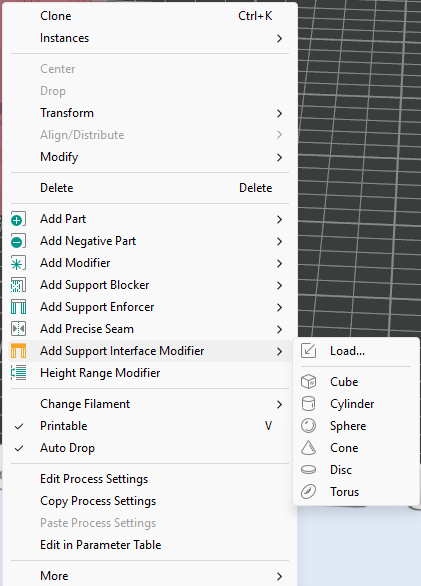
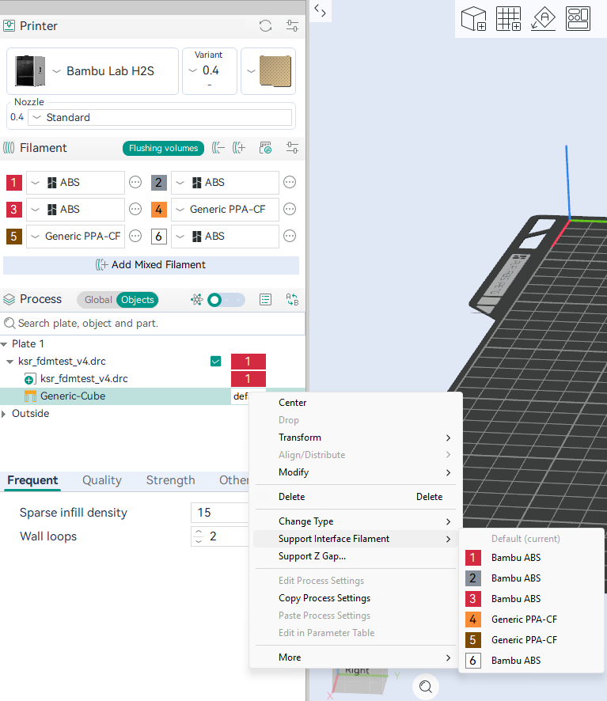
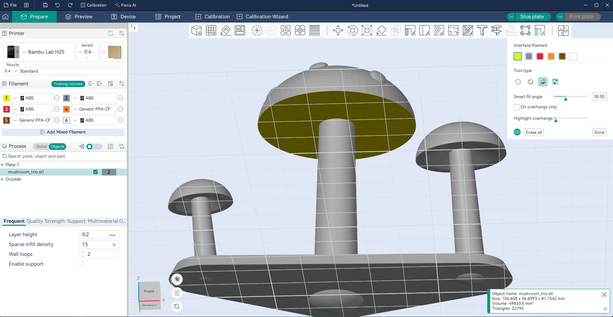
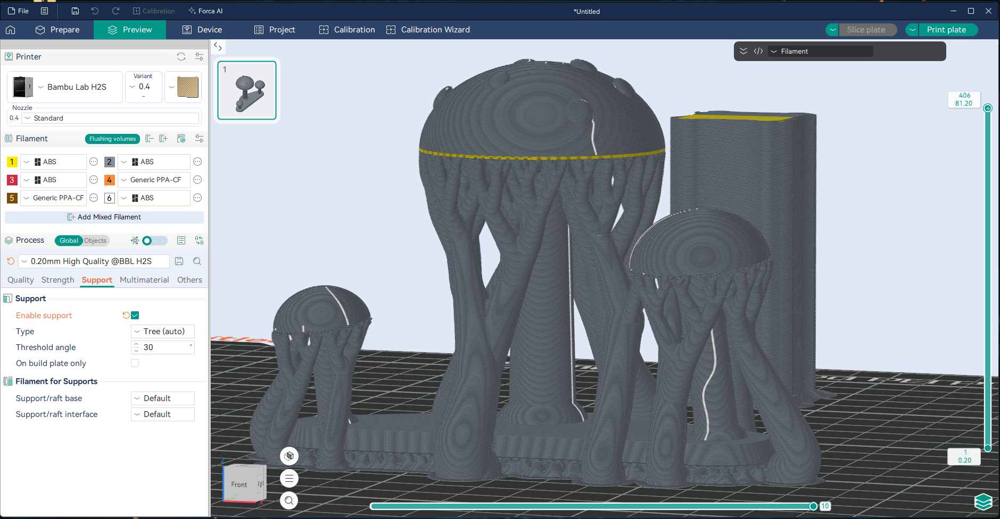

# Regional support interfaces

In OrcaSlicer, every support interface on an object is the same: one interface filament, one top Z gap. Forca lets
you give **part of a model** its own support interface. The classic use is a clean release under one surface: a
PETG interface under a PLA part (the two don't stick to each other, so the support peels off cleanly) printed only
where that surface needs it, while the rest of the supports stay plain PLA.

A region can have:

- its own **interface filament**, and
- its own **top Z gap**, including a flush 0 mm gap (which a dissimilar interface filament allows).

Everything else about the supports (type, pattern, density, interface layers) still comes from the object's settings.
It works with **Grid, Snug, Tree (Slim / Strong / Hybrid) and Organic** supports. An object without a region slices
exactly as in OrcaSlicer.

There are two ways to mark a region: **place a box** or **paint the surface**.

## Before you start

- Turn supports on for the object as usual.
- Load the interface filament as one of the project's filaments (the Filament list in the sidebar), and on a
  multi-material printer make sure it's in the slot the print will use.

## Place a box (support-interface modifier)

1. Right-click the object > **Add Support Interface Modifier**, and pick a shape.
2. Move and scale the box so it covers the area whose supports should get the special interface. What counts is the
   footprint seen from above: interface toolpaths under the box use the region's settings.
3. In the object list, right-click the modifier:
   - **Support Interface Filament**: the filament for this region's interface (**Default** keeps the object's own).
     The object list shows the choice in the modifier's filament column.
   - **Support Z Gap...**: the region's gap in mm, used above and below the interface. If you never set it, the
     object's gaps apply and only the filament changes. Once set, it can be changed but not cleared (Undo takes it
     back).

Several boxes can each have their own filament.

## Paint the surface

1. Select the object and open **Support Interface Regions** in the toolbar of paint tools.
2. Under **Interface filament**, pick the filament for the region.
3. Paint the faces that will rest on the support (left mouse button paints, right mouse button erases,
   **Ctrl + mouse wheel** changes the brush size). The tools are the usual ones: Circle, Sphere, Fill and Gap Fill.
4. Helpers:
   - **On overhangs only** paints only faces that overhang, by the **Highlight overhangs** angle.
   - **Vertical** / **Horizontal** lock the stroke to one direction.
5. Press **Done**.

Each painted filament becomes its own region. **A painted region always uses a flush 0 mm gap**: painting is meant
for a dissimilar interface filament, which releases without a gap. For another gap, use a box.

## Check it before printing

Slice, go to **Preview** and look at the support interface layers under the region:

- the interface under the region is in the region's filament, and nowhere else;
- the gap under the region is what you set.

Then print a small test first; release depends on the filament pair and the printer.

## Limits

- **One gap per object.** Each region can have its own filament, but all regions on one object share one top Z gap.
  If two areas need different gaps, split them into separate objects.
- Regions are a Forca feature: other slicers don't know them.
