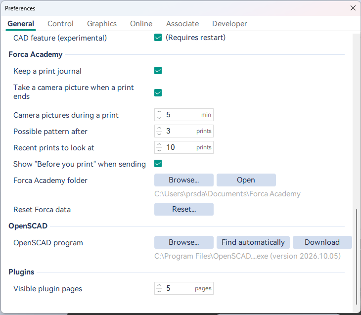
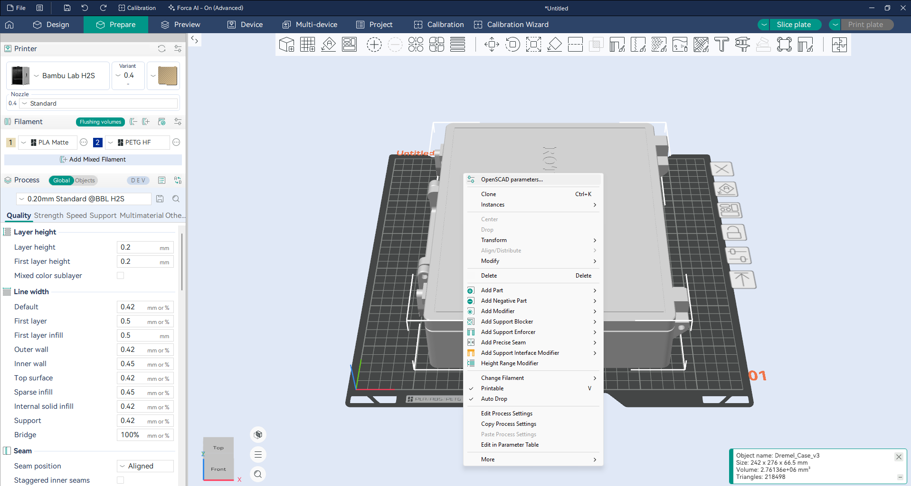
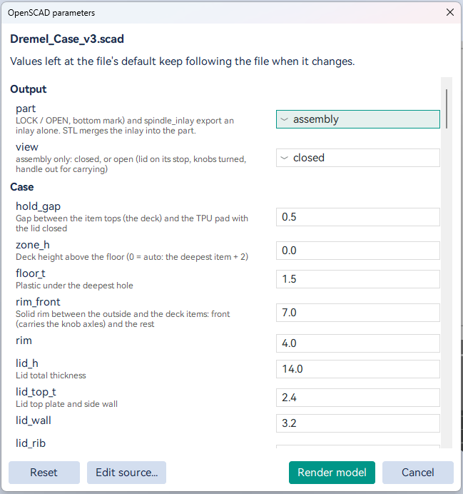
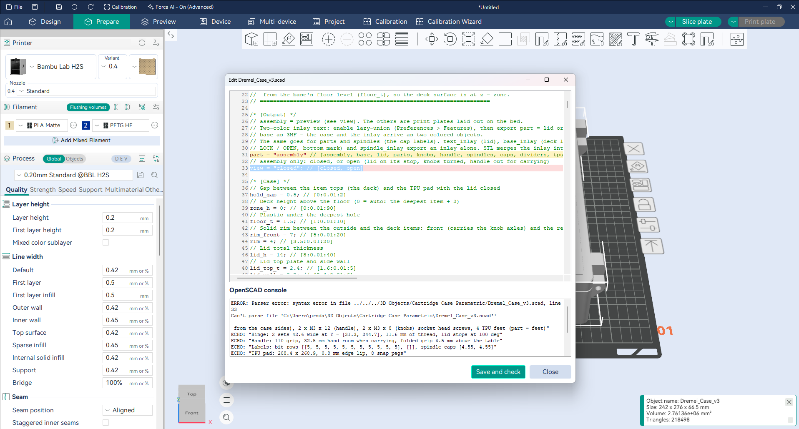

# OpenSCAD in Forca

Many parametric models are written in [OpenSCAD](https://openscad.org): a `.scad` file whose Customizer lets you set
sizes, options and text before you render it. Forca opens these files directly. You don't have to render and export
an STL in OpenSCAD first, and you can change the parameters later without leaving Forca.

What you can do:

- [Open a `.scad` file](#open-a-scad-file) and get the model on the plate in one step.
- [Change its parameters](#change-the-parameters) in Forca and render it again in place.
- [Fix a line or two](#fix-a-problem-in-the-file) of the file in a small editor that shows OpenSCAD's messages.
- [Edit it in OpenSCAD](#edit-in-openscad) and have Forca render it again when you save.
- [Start a new model](#start-a-new-model) from a starter file.
- Get its [colours as filaments](#colours).
- [Let your AI design a part](#forca-ai) in OpenSCAD, if you use Forca AI.
- [Save the project](#what-the-project-keeps) and re-render it later, on another computer or after the file is renamed.

## Set up OpenSCAD

Forca doesn't include OpenSCAD. It runs the OpenSCAD you install, as a separate program, only when you open a `.scad`
file. This keeps your OpenSCAD up to date and separate from Forca.

1. Install a **development snapshot** of OpenSCAD from 2025 or later: on [openscad.org/downloads](https://openscad.org/downloads.html),
   scroll to **Development Snapshots** and take the Windows installer. The last regular release (2021.01) is too old:
   it has neither the fast Manifold renderer nor the parameter export Forca needs.
2. Forca finds it in the usual install folders by itself. To check, or to choose another one, open
   **Preferences → General → OpenSCAD**:
   - the line under the buttons shows which `openscad.exe` Forca uses and its version, or that it's too old;
   - **Browse...** picks an `openscad.exe` yourself;
   - **Find automatically** goes back to the newest one installed;
   - **Download** opens OpenSCAD's download page.

Without a usable OpenSCAD, opening a `.scad` file tells you what to install.

## Open a `.scad` file

Use **File → Import → Import 3MF/STL/STEP/SVG/OBJ/AMF...** (`.scad` files are listed with the other model files, and
under their own "OpenSCAD files" filter), or drop the file on Forca's window.

Forca renders the file in the background with the file's default parameters; the progress notification has
**Cancel**, and a render that takes longer than ten minutes is stopped. The model lands on the plate named after the
file, as one undo step. If OpenSCAD can't render it, Forca shows OpenSCAD's warnings and errors.

The object stays **linked** to its `.scad` file: that's what the rest of this guide uses. (A file that renders as
several separate objects, for example with OpenSCAD's "lazy union" turned on, is imported but not linked: see
[Limits](#limits).)

## Change the parameters

Right-click the object → **OpenSCAD parameters...** (at the top of the menu; it's only there for a linked object).

The dialog shows the file's Customizer: the parameters in the file's groups, each with the description the file gives
it, as text fields (numbers, text and lists like `[40, 30]`), checkboxes and dropdowns. A number field's tooltip shows
the range the file allows. The values are the ones you chose last time.

- **Render model** renders the file with your values in the background and **replaces the model in place**: it keeps
  its position on the plate, its modifiers, and the settings and names of its parts. It's one undo step, so
  **Ctrl+Z** brings the previous model back. Before rendering, Forca checks that each number field holds a number and
  each list field a list.
- **Reset** sets every parameter back to the file's default.
- **Edit source...** opens the [editor](#fix-a-problem-in-the-file).
- **Cancel** closes the dialog and changes nothing.

Only the values you change are stored. A value you left at the file's default keeps following the file: if the file's
default changes later, the next render uses the new default.

## Fix a problem in the file

**Edit source...** opens the `.scad` file in a small editor, with OpenSCAD's console below it. It's meant for a quick
fix, a missing `;` or a wrong number, not for writing models: use OpenSCAD or your own editor for that.

- Line numbers and OpenSCAD colouring (keywords, built-in modules, numbers, strings, comments).
- **Red** marks a line OpenSCAD names in a warning or an error; the first error is selected.
- **Yellow** marks the line before a **syntax error**. OpenSCAD reports a syntax error on the line where it got
  stuck, which for a missing `;` or bracket is usually the line *after* the mistake. In the picture the `;` is
  missing at the end of line 31 (yellow); OpenSCAD reports line 33 (red), because line 32 is only a comment.
- **Save and check** saves the file and has OpenSCAD render it with your current values, then shows its new messages
  (`ECHO`, `WARNING`, `ERROR`). It doesn't change the model on the plate.
- **Close** asks first if you have changes that aren't saved.

When you close the editor, Forca reads the parameters from the file again, so a parameter you added or changed shows
up in the dialog. Then press **Render model** to update the plate.

If OpenSCAD can't read the parameters, or a render fails, Forca shows the messages and offers to open the file in the
editor.

Forca saves the file with the line endings it already had. Undo (**Ctrl+Z**) works in the editor until you close it.

## Edit in OpenSCAD

For more than a quick fix, right-click the object > **Edit in OpenSCAD**. The file opens in OpenSCAD's own window, with
its preview and everything else OpenSCAD offers. When you save it there, Forca asks **"... has changed. Render the model
again?"**; **Yes** renders it with your values and replaces the model in place, as one undo step. Objects on the plate
made from the same file are each rendered with their own values.

Forca watches the file until no object on the plate uses it any more, or until you close Forca.

## Start a new model

**File > Import > New OpenSCAD model...** asks where to save the new `.scad` file, then puts a starter model on the
plate and opens the file in OpenSCAD. The starter is a box with rounded corners whose width, depth, height, corner
radius and an optional hollow inside are Customizer parameters, with comments that explain how to make your own. Change
it in OpenSCAD and save: Forca renders it again, as above.

## Colours

When a file uses OpenSCAD's `color()`, the model arrives in colour: each colour goes to the project filament closest to
it, the faces in that colour are painted with that filament, and the most common colour becomes the object's filament.
Faces without a `color()` keep the object's filament.

Load the filaments you want before importing (the Filament list in the sidebar): colours only map to filaments the
project has, so two colours closest to the same filament print in that one. You can change the painting afterwards with
the colour painting tool, as for any model; rendering the file again paints it from the file's colours again.

## Forca AI

If you use [Forca AI](guides/forca-ai.md), your AI assistant can use OpenSCAD too: ask it to design a part, and it
writes the OpenSCAD code, renders it onto the plate with your OpenSCAD, looks at the result and adjusts the code. It
reads the parameters of your files, and renders them with other values.

- The AI's files go into `Documents\Forca AI\OpenSCAD`, named "<name> (Claude <date>).scad". It can't change your own
  `.scad` files at the Guarded level.
- The models it makes are linked like any other, so **OpenSCAD parameters** and **Edit in OpenSCAD** work on them, and
  you keep the file.

## What the project keeps

When you save the project (`.3mf`), each linked object keeps:

- the path of its `.scad` file,
- the file's text at the last render,
- the values you changed.

So the parameters still work after you move or rename the `.scad` file, or open the project on another computer: if
the file isn't where it was, Forca uses the text saved in the project. In that case **Edit source...** edits a
temporary copy, and your changes stay in the project when you render, not in any file.

Other slicers ignore this part of the project and open the model as a normal mesh.

## Limits

- **One object per file.** A file whose top level renders as several objects (OpenSCAD's lazy union) is imported
  unlinked, and a re-render that gives several objects is refused: Forca only ever replaces one object with one.
- **Libraries.** A file that uses a library (`include <BOSL2/std.scad>` and the like) needs that library where
  OpenSCAD looks for it: OpenSCAD's library folder, or a folder in `OPENSCADPATH`. If it renders in OpenSCAD, it
  renders in Forca.
- **A `.scad` file is code.** It can read files on your computer (`import()`, `include`), though it can't run
  programs. Opening it in Forca trusts it as much as opening it in OpenSCAD does.
- **Edits made outside Forca** are only watched for files opened with Edit in OpenSCAD or New OpenSCAD model in this
  session. Otherwise open **OpenSCAD parameters** and press **Render model** to pick up the changes.
